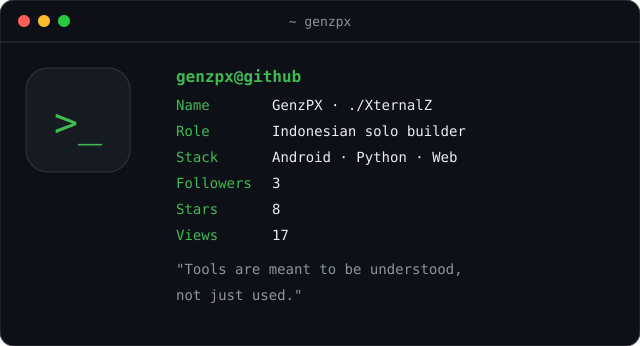
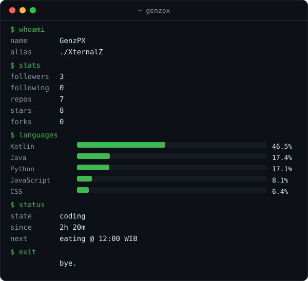
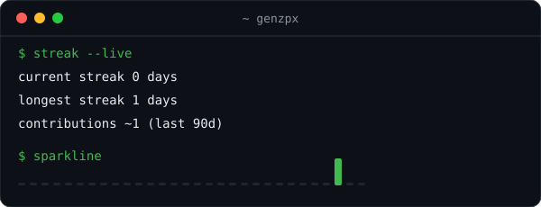

 

 

  

## Hey, I’m GenzPX / ./XternalZ

I build tools to solve my own problems. If they solve yours too, even better.

Offline-first, built from scratch, and no framework religion — just tools I actually use. If you find something useful, a star is always appreciated.

---

## 🧰 What I build

Personal projects, practical tools, and things I wanted to exist.

<!-- PROJECTS:START -->

| Project | Description |
| :--- | :--- |
| [**internet-surfers-is**](https://github.com/GenzPx/internet-surfers-is) | internet surfers android |
| [**shower-simulator**](https://github.com/GenzPx/shower-simulator) | unity android calculator |
| [**MonitoredCheck**](https://github.com/GenzPx/MonitoredCheck) | system monitor app |
| [**EduKids**](https://github.com/GenzPx/EduKids) | kids learning app |
| [**STANG**](https://github.com/GenzPx/STANG) | stang — python |
| [**CasperVerse**](https://github.com/GenzPx/CasperVerse) | offline ai system |
| [**music**](https://github.com/GenzPx/music) | offline music player |

<!-- PROJECTS:END -->

---

## 🛠️ Tools I enjoy

No framework religion. Just languages and tools I enjoy building with.

**Languages & storage**

  
  
  
  
  
  
  
  

**Platforms & libraries**

  
  
  
  

A few other interests

  
  
  

---

## 📊 Activity

Open the terminal — stats, streak & contributions

  

  

  

  

---

## 🌐 Find me around

  
  
  
  
  
  
  

> 🏢 Also cooking things under **[Sedot WC Studio](https://studiosdtwc.totalh.net/)**.

---

 

*"Tools are meant to be understood, not just used."*

 

`cd ~/life && ./build --from-scratch`

